# Mist Theme (`dsh-theme-mist`)

[简体中文](README.md) | **English**

A hot-pluggable client theme plugin for **DeepSeek Harness** (Desktop & Web).

Inspired by the visual language of [DSH Go](https://github.com/ccch1mneyyy/dsh-Go), Mist ports the mobile reference design's colour, material and corner-radius language to Desktop and Web, reshaping the interface with **low-saturation neutrals, layered glass and paper-and-ink surfaces, 0.5px hairline borders, frosted glass chrome, and a single corner accent glow**.

<table>
  <tr>
    <td width="50%">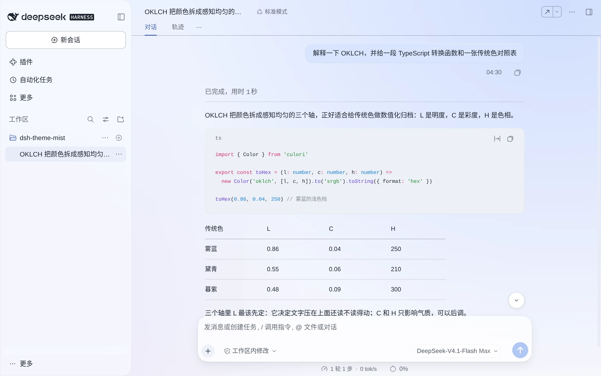<br><sub><b>Light</b> · Mist · glass sidebar</sub></td>
    <td width="50%">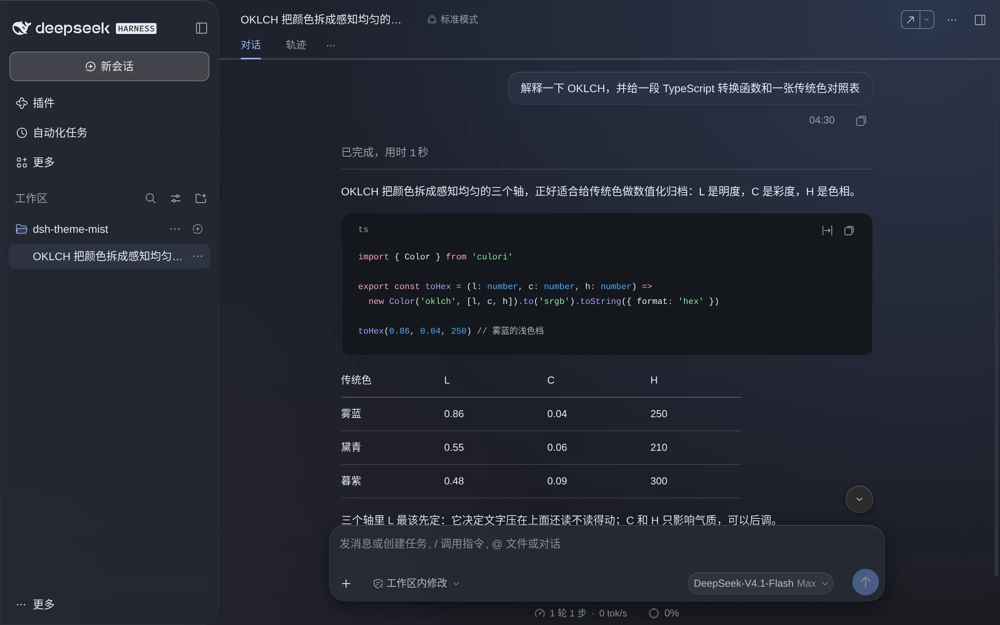<br><sub><b>Dark</b> · Mist · glass sidebar</sub></td>
  </tr>
</table>

---

## Preview

Mist includes six curated accent palettes. The top-right ambient glow, primary action buttons, active indicators, and hue-tinted paper/night surfaces adapt automatically to the selected accent.

<table>
  <tr>
    <td align="center">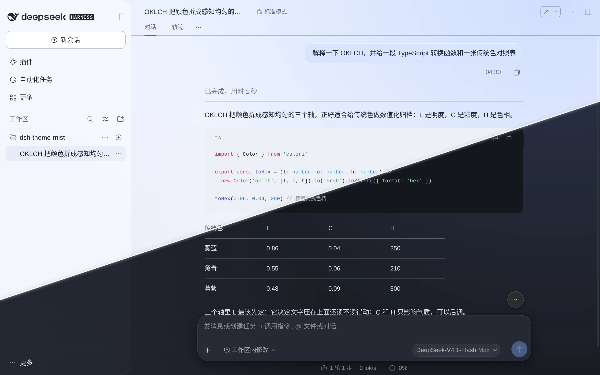<br><sub><b>Mist</b></sub></td>
    <td align="center">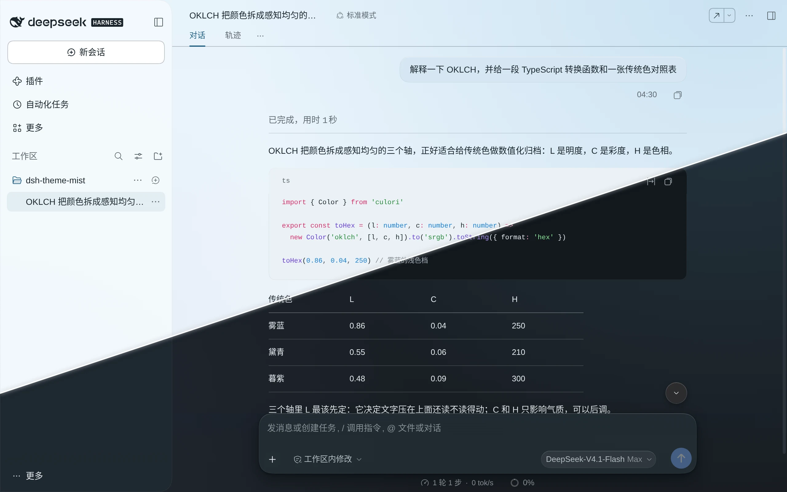<br><sub><b>Daiqing</b></sub></td>
    <td align="center">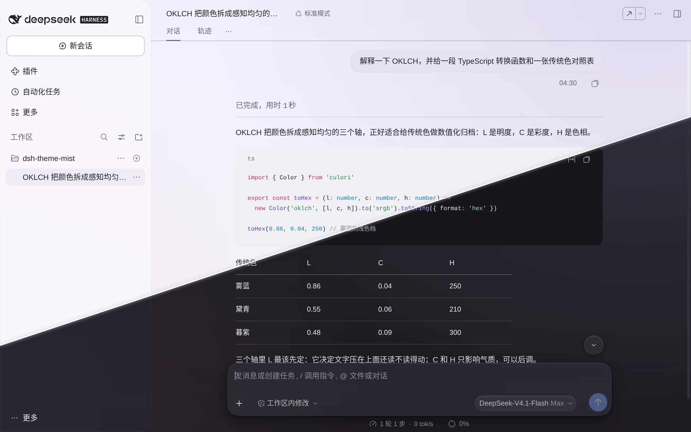<br><sub><b>Dusk</b></sub></td>
  </tr>
  <tr>
    <td align="center">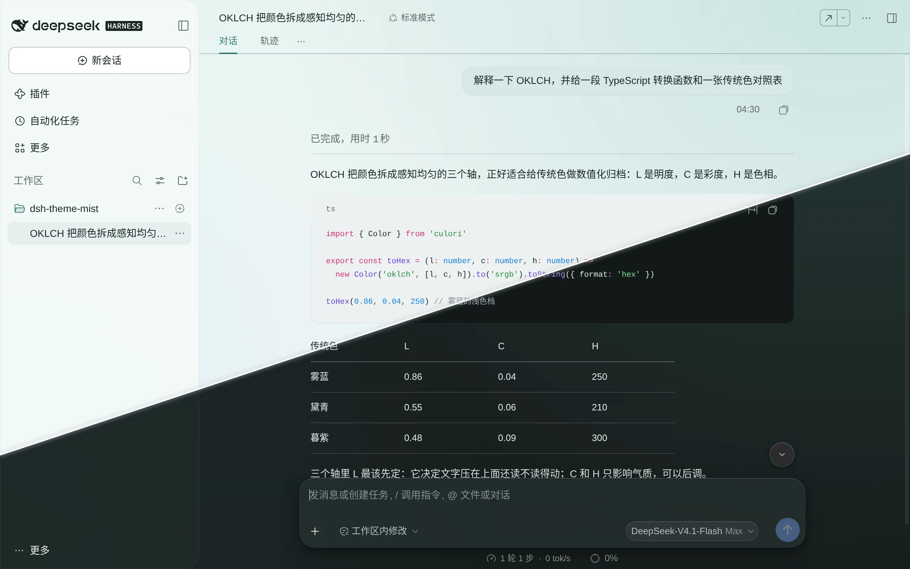<br><sub><b>Turquoise</b></sub></td>
    <td align="center">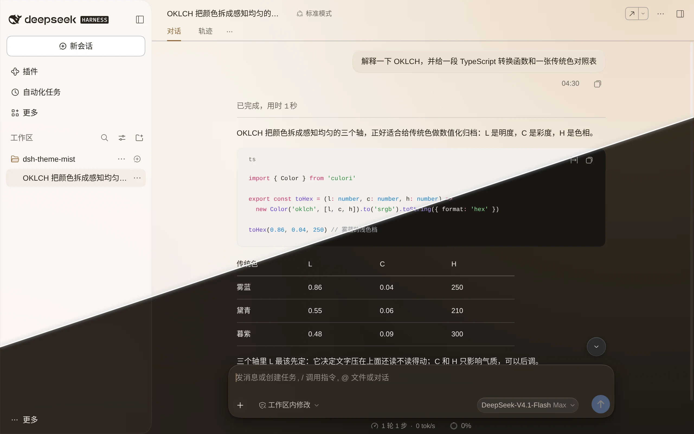<br><sub><b>Amber</b></sub></td>
    <td align="center">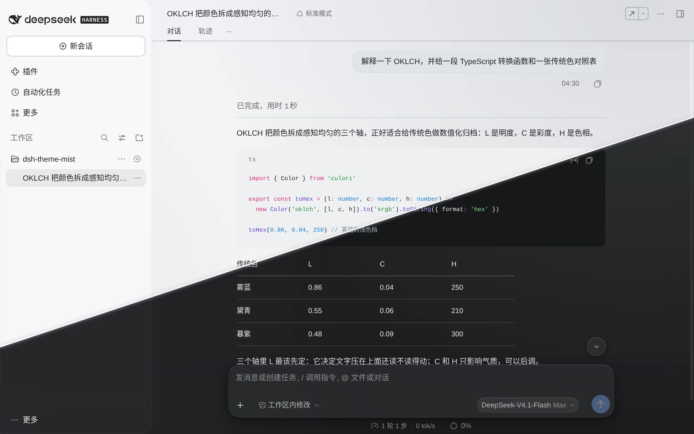<br><sub><b>Graphite</b></sub></td>
  </tr>
</table>

---

## Features

- **Six Accents × Light / Dark / System**: Seamlessly layers Mist, Daiqing, Dusk, Turquoise, Amber, and Graphite over the host's Light, Dark, and System appearance modes. Cool-white paper surfaces in light mode and a blue-shifted slate in dark mode (never pure black) pass WCAG AA contrast checks across all 12 combinations.
- **Restrained Accent Budget**: Saturated color is reserved strictly for primary actions, active selections, and the subtle top-right glow. Depth is defined through luminance steps and 0.5px hairlines.
- **Frosted Glass & Dual Sidebar Materials**: The floating composer bar blurs scrolling messages underneath in real time, while the left sidebar offers a one-click choice between **Glass** and **Flat**.
- **Native Settings Integration & Clean Teardown**: Integrates directly into **Settings → General**. Disabling or uninstalling the plugin restores every host token and stylesheet with zero DOM residue.

---

## Installation

### Desktop

1. Clone and build the plugin locally (skip `pnpm build` if `lib/` is already present):
    ```bash
   git clone <repo-url> dsh-theme-mist
   cd dsh-theme-mist
   pnpm install && pnpm build
    ```
2. In the Desktop app, open **Plugins → Add plugin** and enter the `dsh-theme-mist` local folder.

### Web

```bash
pnpm install && pnpm build
dsh plugin --profile web add "$(pwd)"
```

---

## Customization

Once installed, open **Settings → General** to find the two new rows:

| Setting | Options | Description |
|---|---|---|
| **Accent** | `Mist` · `Daiqing` · `Dusk` · `Turquoise` · `Amber` · `Graphite` | Switches instantly when you click a swatch. |
| **Sidebar material** | `Glass` (Default) · `Flat` | **Glass**: Translucent sheet with a 0.5px hairline border and 28px right corners. **Flat**: Removes the sidebar backing so the page gradient flows seamlessly across all columns. |

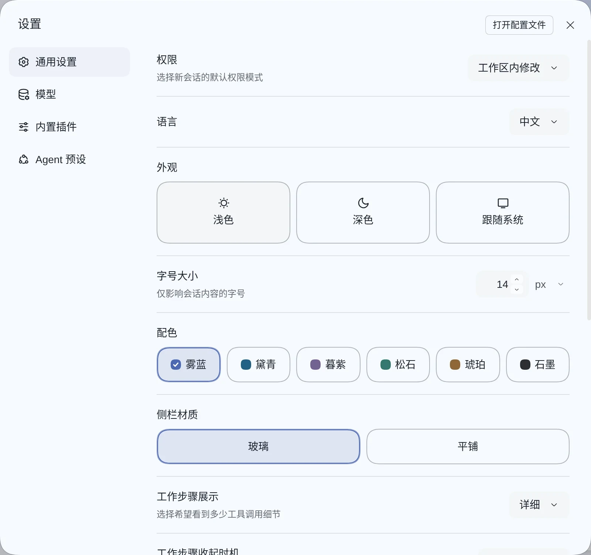

The two sidebar materials compared (same accent):

<table>
  <tr>
    <td align="center">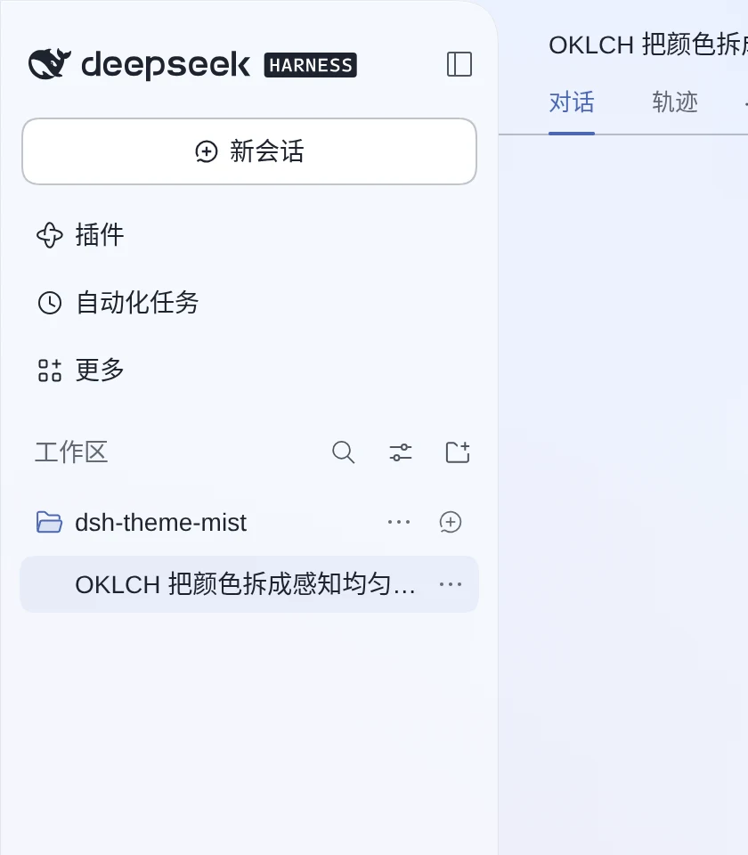<br><sub><b>Glass</b> (default)</sub></td>
    <td align="center">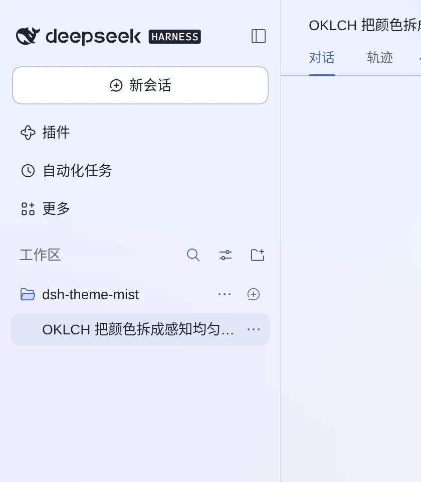<br><sub><b>Flat</b></sub></td>
  </tr>
</table>

---

## Uninstallation

- **Desktop App**: Open **Plugins**, locate **Mist theme (`dsh-theme-mist`)**, and click Remove.
- **Web**:
  ```bash
  dsh plugin --profile web remove dsh-theme-mist
  ```

---

## Development & Documentation

```bash
pnpm install          # Install dependencies
pnpm build            # Emit lib/index.js (Node) and lib/client.js (Browser)
pnpm verify           # Build + typecheck + unit tests + palette/token/pack contract checks
```

For architectural details, token derivation math, and end-to-end verification harnesses, see:

- [Architecture (`docs/architecture.md`)](docs/architecture.md) — Loader lifecycle, 3-layer theme model, and cleanup contract
- [Visual Specification (`docs/visual-spec.md`)](docs/visual-spec.md) — OKLCH derivation, contrast matrix, the page gradient and glow, and the four-tier glass recipes
- [Palette Tables (`docs/reference/palette-tables.md`)](docs/reference/palette-tables.md) — Complete generated light/dark token values for all six accents
- [Tooling Guide (`tools/README.md`)](tools/README.md) — Token generator, dual-version E2E scripts, and automated preview capture
- [Changelog (`CHANGELOG.md`)](CHANGELOG.md) — Release history

---

## License & Attribution

Released under the **[MIT License](LICENSE)**. Full attribution and clean-room implementation details are recorded in **[NOTICE](NOTICE)**.

- **Clean-Room Implementation**: Visual design inspired by [DSH Go](https://github.com/ccch1mneyyy/dsh-Go) (with portions of the upstream theme vocabulary originating from [PiPilot](https://github.com/CikeSeven/pi_pilot), MIT). All TypeScript/CSS source code, icons, and the OKLCH derivation script (`tools/derive-tokens.py`) in this repository were written independently — **no Dart source code, brand logos, mascots, or artwork from DSH Go are included**.
- **Non-Affiliation**: This is an independent community plugin and is not affiliated with, endorsed by, or published by DSH Go, DSH-TUI, ccch1mneyyy, or DeepSeek.
