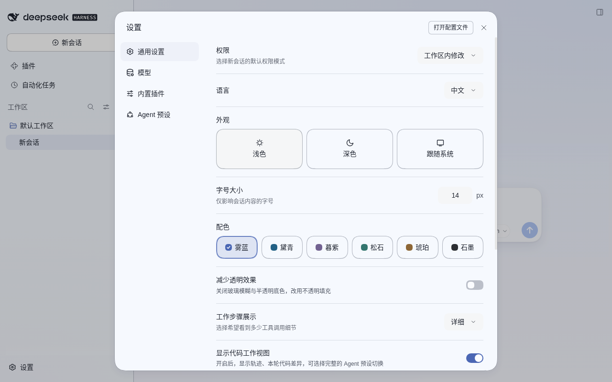
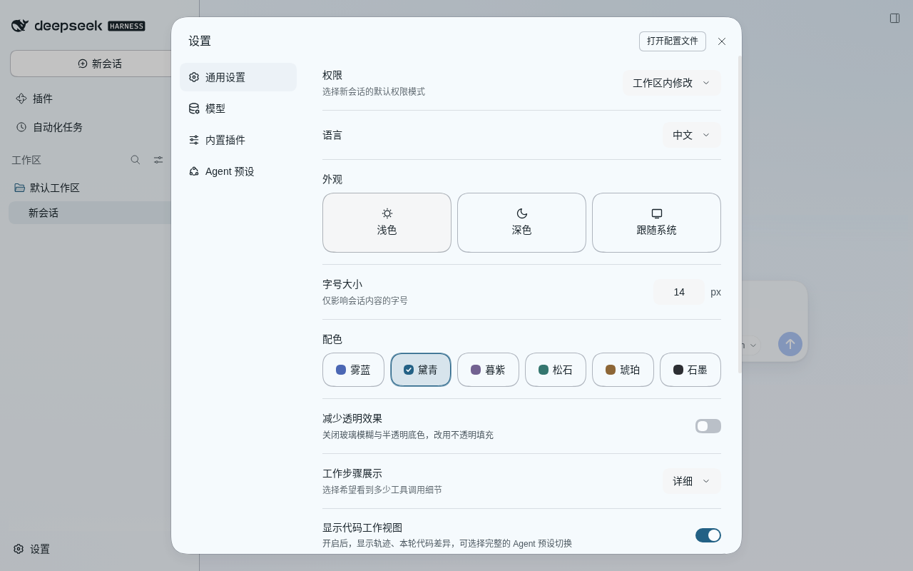
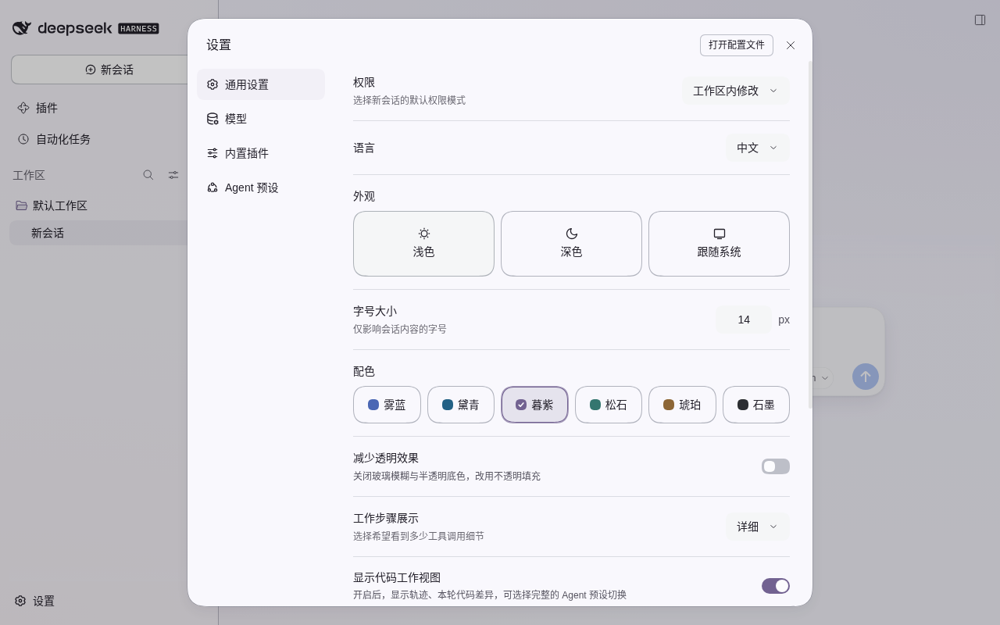
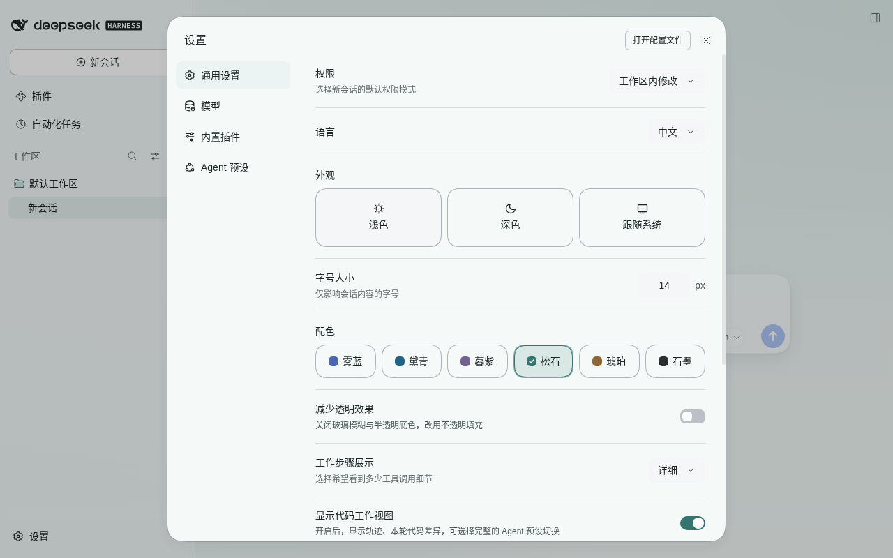
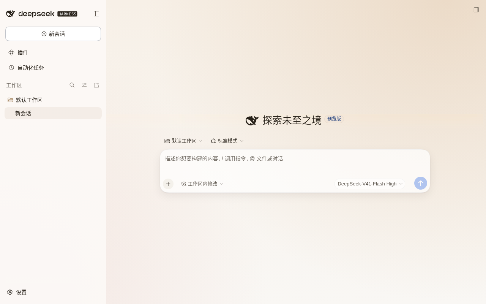
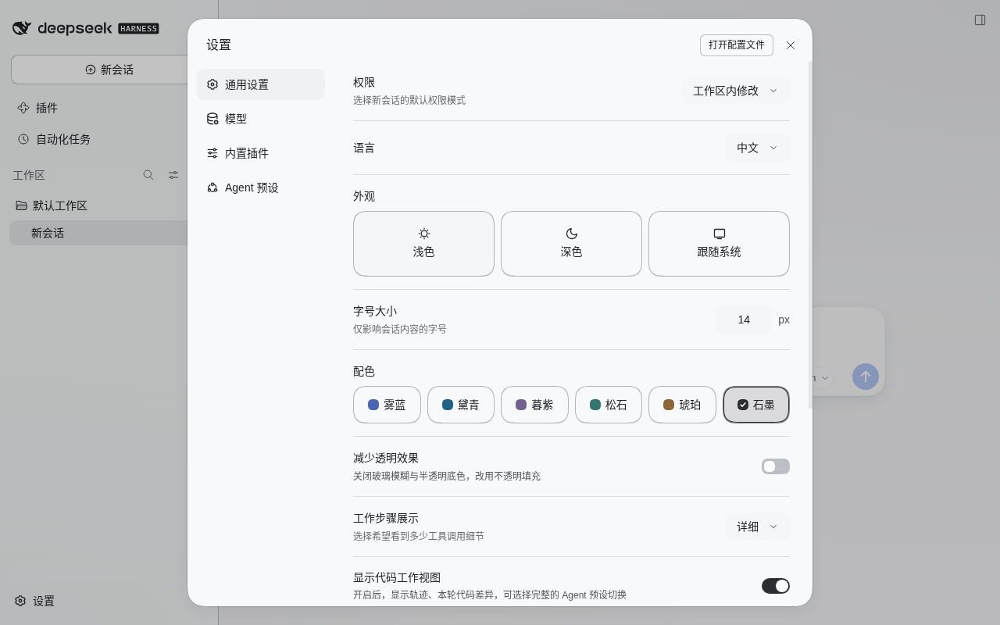

# dsh-Go-theme

把 [DSH Go](https://github.com/ccch1mneyyy/dsh-Go)（DeepSeek Harness 的 Android 客户端，Flutter）的视觉语言，移植成 DSH 桌面端 / Web 端的**客户端主题插件**。

装上之后，官方界面获得同源的设计语言：六套强调色、分层渐变表面、玻璃材质、发丝描边、连续圆角、克制的动效节奏。**信息架构保持官方三栏布局不变** —— 换的是视觉，不是交互模型。

本项目是独立重实现，不含 DSH Go 的代码、素材或字体。

## 现在的状态

阶段 0–3 已完成：令牌层与材质层可用，装上即变色；「设置 → 通用」里有「配色」「侧栏材质」两行，六套强调色与侧栏材质都能在界面里完成，不需要改配置或写脚本。

阶段 4 已完成：客户端两版（`0.2.1-alpha.1` 与 `0.2.2-alpha.2`）的渲染一致性、八个交叉场景、降级路径与**卸载清洁度**都有脚本可重跑；桌面端 Electron 窗口内的实际效果已确认，不需要版本分支。

阶段 5 进行中：打包内容契约（`pnpm check:pack`）与 `NOTICE` 已就位；README、预览图与卸载说明补齐后，剩下的只有发布闸门本身。

## 安装

### 桌面端

应用内「插件 → 添加插件 → 本地目录」，选本仓库目录即可。

> 桌面端的 `desktop` profile 对 CLI 硬拒绝（`boot` / `--dump-config` / `dsh plugin` 全部不可用），只能走界面。

### Web 端

```bash
pnpm install && pnpm build                     # 生成 lib/，缺了它 Host Loader 导入会失败
dsh plugin --profile web add "$(pwd)"          # 装进自带的 web profile
```

包清单里声明了 `dsh.bundle`，所以 `add` 之后会被写进该 profile 的 `dsh.profile.bundles` —— 这是「能不能当层」的唯一开关，只进 `dependencies` 而不进 `bundles` 的包完全惰性。

包名是 `dsh-go-theme`（无 scope；npm 新包名不允许大写，所以仓库用 `dsh-Go-theme`、包名是全小写），卸载时用的就是它。

**想用独立 profile，先按 web 模板建一个**：

```bash
dsh themego --from-default-profile web         # 跑一次即建好，然后 Ctrl-C
dsh plugin --profile themego add "$(pwd)"
```

> **别用随便一个名字代替 `web`**。`dsh plugin --profile 新名字 add …` 会把一个只有 `dsh-base` 的空 profile 建出来，那里没有 `dsh-web-app`，装完不起 Web UI、也看不到界面。想独立，就先 `--from-default-profile web`。

### 卸载

```bash
dsh plugin --profile <profile> remove dsh-go-theme
```

桌面端在「插件」页移除。这条命令实测（2026-11-02）：它同时摘掉 `dependencies` 里的条目**和** `dsh.profile.bundles` 里的那一项，再 `add` 回来会重新装回原位。

卸载后页面会回到官方外观：`body` 上的三个 `data-dsh-go-*` 属性、注入的三张样式表、`body` 的内联令牌层与两个事件监听全部被清掉（逐项断言见 `tools/e2e-uninstall.mjs`，两版本各 23 条）。**唯一保留的是偏好本身**——配色与「侧栏材质」记在 `localStorage`，装回来时你上次的选择还在。想彻底清掉：

```js
localStorage.removeItem('dsh.go-theme.preferences.v1')
```

## 支持的版本

**0.2.1-alpha.1 与 0.2.2-alpha.2 都实测过**，两侧渲染逐字段一致（39 个令牌 × 明暗、六套配色、布局矩形、模糊清单），所以不需要版本分支。两个版本的自有样式表数、宿主设置行数确实不同（151/158 张样式表、13/15 行设置），那只是宿主自己的差异。

包清单因此声明了 `engines.dsh: ">=0.2.1-alpha.1 <0.3.0"` —— 这是宿主的兼容门禁真正会读的字段（`engines.dsh` 单独决定；没有它时只检查 `@deepseek-ai/dsh*` 的 peer）。0.3.0 起未验证，会被拦下。

插件依赖宿主提供 `ctx.theme.overrideTokens`。宿主没有它时不会崩：只画材质层并记一条 warn，降级路径见 `docs/architecture.md` §5.2。

## 用法

明暗跟随系统。打开「设置 → 通用」，在「配色」一行里点六色块之一：雾蓝 / 黛青 / 暮紫 / 松石 / 琥珀 / 石墨。切换即时生效、无需刷新，选择写进 `localStorage`；色块本身会随明暗切换显示该配色在对应模式下的主色。

脚本或其他插件可以绕过界面直接驱动，与界面共用同一份状态，选择同样会持久化：

```js
window.dispatchEvent(new CustomEvent('dsh-go-theme:accent', { detail: 'amber' }))
```

输入框上方弹出的浮层（`/`、`@` 菜单）保持正常的背景模糊：此前这层模糊被输入条底座的磨砂与渐隐底带挡住，浮层只剩半透明、背后的字看得一清二楚；现在底座只在浮层打开时让开，浮层一关就恢复磨砂（T5.9）。

「侧栏材质」在同一个位置，两档：

- **玻璃**（默认）：上游抽屉的材质——`mistLow @ 0.82` 的半透明白底、0.5px 发丝描边、顶边高光、右侧两角 28px 圆角。与上游金标准一致。
- **平铺**：不画底板，页面渐变直接穿过去，只留一根 0.5px 分隔线。这是上游右侧详情列的画法，搬到左侧之后侧栏与聊天区同色（`245,249,254` → `235,235,248`），代价是不再匹配金标准的侧栏值，所以做成可选而非默认。

也可以用事件驱动：

```js
window.dispatchEvent(new CustomEvent('dsh-go-theme:sidebar-material', { detail: 'flat' }))
```

## 六套配色

同一页面的六种强调色（点开看大图）。右上角光晕、左侧栏、发送按钮与选中态都跟着配色走，背景渐变与玻璃材质不变——把六张并排看，右上角那一块的色相差异最大（雾蓝偏冷、琥珀偏暖、石墨几乎中性）。

<table>
  <tr>
    <td align="center"><br><sub><b>雾蓝</b> Mist</sub></td>
    <td align="center"><br><sub><b>黛青</b> Daiqing</sub></td>
    <td align="center"><br><sub><b>暮紫</b> Dusk</sub></td>
  </tr>
  <tr>
    <td align="center"><br><sub><b>松石</b> Turquoise</sub></td>
    <td align="center"><br><sub><b>琥珀</b> Amber</sub></td>
    <td align="center"><br><sub><b>石墨</b> Graphite</sub></td>
  </tr>
</table>

拍的是**主页面**（不是设置面板）在全新 profile 下的空状态：没有会话内容，所以不会把任何人的对话带进仓库。图由脚本生成，不是手工截的：

```bash
pnpm preview:accents --language zh   # 需要先 pnpm build，并有一个装好本插件的 profile
# 设置面板那张单图：加 --dialog
```

脚本会自己起实例、关掉首启弹窗、切六次配色、各拍一张（用法见 [tools/README](tools/README.md) §11）。

## 性能

页面上只有**一处新增的真实模糊**（输入区，`blur(18px) saturate(1.25)`）；菜单的模糊是官方材质，不是本项目加的。滚动场景的 A/B 实测（同机同 Chromium，交替跑 `glass` 与「只关掉这层模糊」）**没测到代价**：两个条件都顶到显示器刷新率上限，帧间隔分布一致。

边界要说清：这是 Chrome 而不是 Electron、是脚本滚动而不是真实滚轮、且只在这一台机器上。这个数字不能当作「所有机器都没问题」的证据。

## 已知限制

完整清单在 [架构文档 §6](docs/architecture.md)，这里只列用户会碰到的几条：

| 限制 | 说明 |
|---|---|
| **不是像素级克隆** | DSH Go 是 Flutter、DSH 是 Web DOM，布局引擎、字体栈、滚动模型都不同。复刻的是视觉语言（色彩、材质、节奏、形状），不是逐像素截图。 |
| **不用自定义字体** | 官方插件资源路由只服务 `.svg .png .webp .jpg .jpeg`，不含 `.woff2`。本主题用系统字体栈——与上游「刻意不打包中文字体」的取舍一致。 |
| **没有桌宠 / 品牌字标** | 吉祥物与字标不在 AGPL 授权内，也不适合移动端交互。品牌图稿由宿主内联 SVG 渲染，插件改不了。 |
| **没有移动端交互** | 横向推页、右滑返回、底部 sheet、安全区适配：桌面端没有这些模型，不做。 |
| **不做壁纸取色** | 桌面端无壁纸概念。六套预设配色 + 界面内切换。 |
| **4 处卡片没有底色** | 页面底色由插件关掉（否则光晕透不出来），原来靠页面底色当填充的卡片要各自重绑。其中 4 处只有哈希类名、没有语义属性可挂钩：cordis 业务卡、轨迹页的工具目录条目、会话里的图片缩略图、提问卡（AskQuestionCard）。它们会在次要页面偏平。见 [架构文档 §9.5](docs/architecture.md)。 |
| **工具调用行不分组** | 上游把**连续 ≥3 次**调用收成一行摘要（`toolGroupThreshold = 3`），展开后挂在细线下；桌面端没有这个模型，每次调用各占一行（宿主的整轮过程折叠是另一回事），本主题不改宿主布局。**材质上两边同构**：上游工具行本来就是 32dp 平面行、不画底色（`StreamRowFrame`），玻璃卡只用在审批 / 提问 / 改动 / 产物四种卡上（`ChatCard`）。见 [架构文档 §9.5](docs/architecture.md)。 |
| **不要与其他皮肤同时启用** | 两个皮肤都改同一批 `--dsw-*` 令牌，谁后写谁赢，视觉会打架。见 [架构文档 §7](docs/architecture.md)。 |

## 文档

| 文档 | 内容 |
|---|---|
| [架构](docs/architecture.md) | 加载链、生命周期、清理契约、做不到的事 |
| [视觉规范](docs/visual-spec.md) | 设计令牌规范、`--dsw-*` 映射依据、五层遮挡与材质配方 |
| [官方 token 清单](docs/reference/token-inventory.md) | 0.2.2 运行时可用的 `--dsw-*` 全集（404 个）与可达性分级 |
| [配色表](docs/reference/palette-tables.md) | 六套配色的精确色阶（脚本生成） |
| [ADR-0001](docs/decisions/0001-layered-theme-over-dom-rewrite.md) | 为什么用「官方 token 层 + 插件 CSS」，而不是重写 DOM |
| [ADR-0002](docs/decisions/0002-preference-storage.md) | 偏好为何先放 `localStorage`，以及迁移计划 |
| [变更日志](CHANGELOG.md) | 版本变更记录 |

## 仓库结构

```
package.json                  包清单：dsh.bundle / dsh.client / exports / scripts
cordis.patch.yml              bundle 补丁层（把本包 insert 进 profile 的插件表）
icon.svg                      插件管理器展示图标
LICENSE                       MIT
NOTICE                        来源声明（设计参考、致谢、非官方）
CHANGELOG.md                  变更日志
locale/{en,zh}.json           插件管理器静态元数据（插件列表里的标题与描述）
build/
  tsdown.client.ts            构建预设：node 半侧 ESM + 浏览器半侧 CJS 闭包工厂
  web-platform.ts             与宿主共享的模块表（客户端 bundle 的 externals）
src/
  index.ts                    Node 半侧（空实现，纯浏览器插件）
  client/index.ts             浏览器半侧入口（inject + apply + 清理）
  client/state.ts             强调色与侧栏材质的状态机
  client/preferences.ts       偏好持久化（localStorage，带降级）
  client/tokens.ts            官方令牌覆盖层 + 材质变量
  client/writer.ts            令牌层的写入与能力降级（没有 overrideTokens 时只写材质变量）
  client/palettes.ts          六套配色（由脚本生成，勿手改）
  client/settings.tsx         设置 → 通用里的两行：配色、侧栏材质
  client/settings.module.css  该行的样式（只读 --dsw-* 令牌）
  client/strings.ts           该行的中英文案（ctx.locale 字典）
  client/dsh-slots.d.ts       槽位服务的类型声明（坑位契约，实测得出）
  client/dsh-locale.d.ts      翻译服务的类型声明
  client/theme.module.css     令牌之外的视觉层
  client/material.module.css  材质层：玻璃、卡片、圆角、发丝线、动效
tests/                        单元测试（令牌契约、材质规则、偏好、文案键）
tools/                        推导脚本、契约校验、e2e 与性能测量
docs/                         架构、视觉规范、ADR、参考资料
docs/images/accents/          六套配色的预览图（由 tools/preview-accents.mjs 生成）
```

## 开发

```bash
pnpm install          # tsdown + lightningcss + typescript + @types/{node,react} + vitest
pnpm build            # → lib/index.js（Node 半侧）+ lib/client.js（浏览器半侧）
pnpm typecheck        # tsc --noEmit
pnpm test             # vitest 单测
pnpm check:pack       # 打包内容契约（`npm pack --dry-run` 的 22 条断言）
pnpm verify           # build + typecheck + test + 三个契约校验（配色 / 令牌 / 打包）
```

集成测试要真实浏览器与服务，单独跑（用法见 [tools/README](tools/README.md)）：

```bash
pnpm e2e:lifecycle --url 'http://127.0.0.1:PORT/?token=...' --profile ~/.dsh/profiles/<profile>
pnpm e2e:degraded                                            # 降级路径，自带静态服务与 headless Chrome
pnpm e2e:dual --desktop-runtime <桌面端 resources/app/dsh>    # 双版本逐字段 diff
pnpm e2e:uninstall                                           # 卸载清洁度审计（自带临时 DSH_HOME）
pnpm e2e:scenarios --desktop-runtime <桌面端 resources/app/dsh>  # 8 个交叉场景 + 截图
pnpm preview:accents --dialog --language zh                  # 重新生成 README 里的六套配色预览
```

## 四条约束

1. **桌面端装插件只能走应用内界面**。官方 CLI 对 `desktop` profile 硬拒绝，没有环境变量后门。
2. **不承诺像素级克隆**。DSH Go 是 Flutter 渲染，DSH 是 Web DOM，布局引擎、字体栈、滚动模型都不同。能承诺的是「视觉语言一致」，不是「截图逐像素一致」。
3. **字体不能通过官方资源路由分发**。`/plugins/<pkg>/assets/` 只服务 `.svg .png .webp .jpg .jpeg`，**不含 `.woff2`**。所以主题只用系统字体栈。
4. **品牌与吉祥物不可复用**。DSH Go 的名称标识、Deepy 小鲸鱼、鲸娘、README 展示图不在 AGPL-3.0 授权范围内。本项目全部重绘，且不使用上游任何图形。

## 许可与来源

本仓库代码以 [MIT](LICENSE) 发布。第三方来源声明见 [NOTICE](NOTICE)。

- **非官方**。本项目与 DSH Go、DSH-TUI、ccch1mneyyy、DeepSeek 均无关联，也未获其背书；「DeepSeek Harness」只是它挂载的宿主应用。
- 设计参考固定在 DSH Go 的 `ca3c4202f0110a9a10311034d532eafd9ee2e290` 这个提交上（源码层是 AGPL-3.0）。上游主题文件头写明部分设计源自 [PiPilot](https://github.com/CikeSeven/pi_pilot)（MIT，© 2026 CikeSeven），NOTICE 里一并致谢。
- 本仓库**不含** DSH Go 的代码、素材、字体或图标。视觉语言是独立重实现，不做代码移植：色值、色相/彩度参数、圆角与间距刻度都按**事实数据**处理，由 `tools/derive-tokens.py` 重新算出，而不是从源文件里搬过来；`tools/check-dart-constants.py` 只在上游源码在场时做数值比对，仓库里不落地任何上游文件。
- [色值底账](docs/reference/palette.json) 里的色值属于**功能性数据**，由 `tools/derive-tokens.py` 从 DSH Go 公开仓库的配色常量推导而来；脚本把数值作为常量硬编码，运行时不读取、也不分发上游源码。
- DSH Go 的品牌与美术素材（名称标识、Deepy、鲸娘、展示图等）版权归 ccch1mneyyy 所有，**不在本项目的许可范围内**，本项目也不使用它们。
